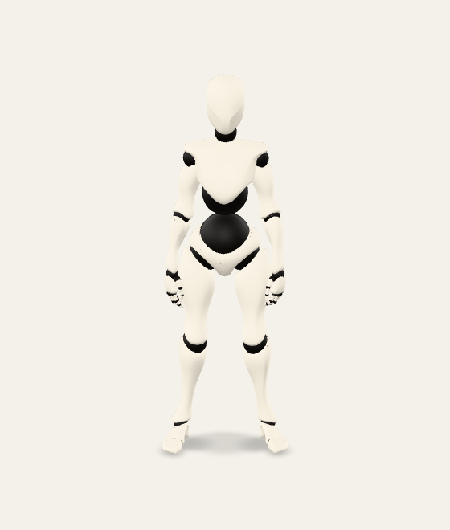
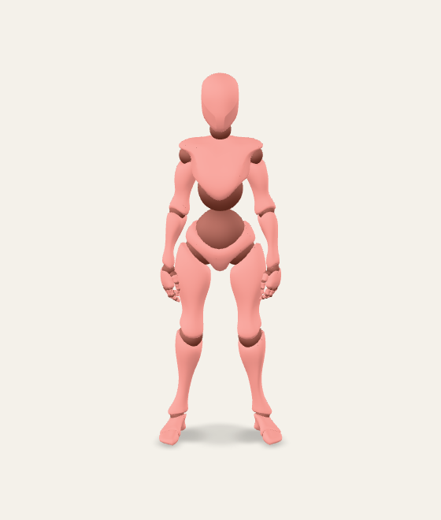
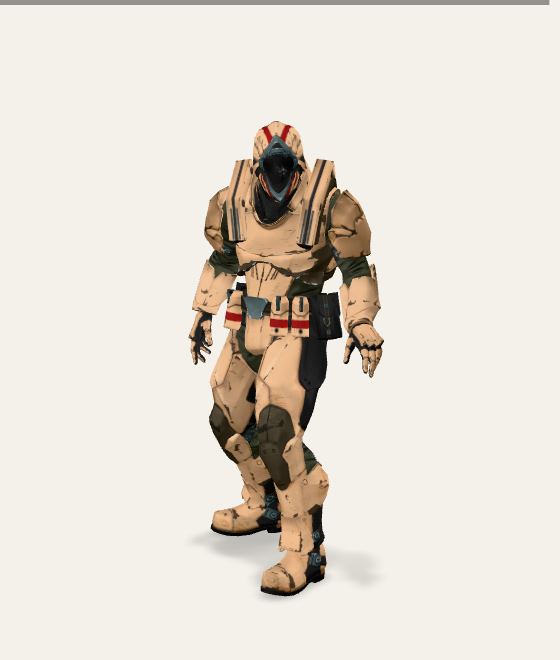
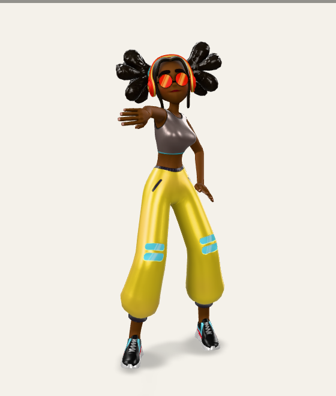
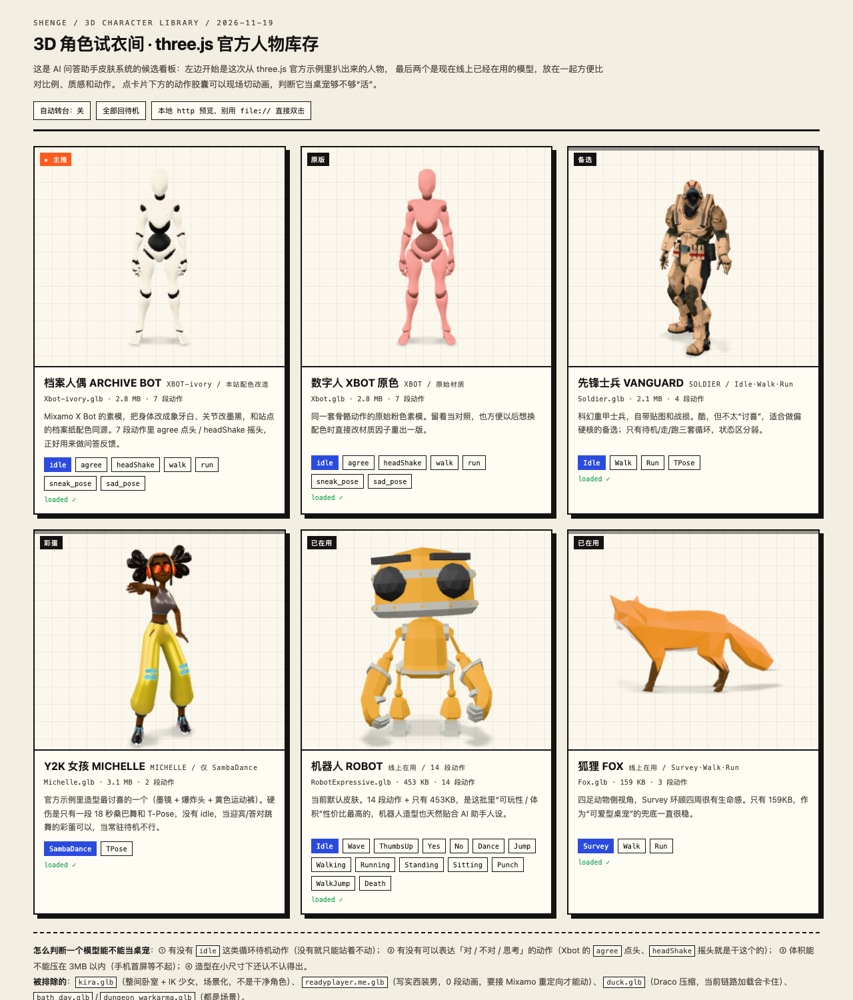

# three.js 官方 3D 人物库存调研（2026-11-19）

> 文档定位：`docs/ai-avatar-skins.md`（右下角 AI 助手视觉层单一依据）的**补篇**。那份管"皮肤系统怎么跑"，这份管"角色素材从哪来、还有哪些能用"。
> 起因：皮肤库里的 3D 角色只有机器人 ROBOT 和狐狸 FOX，缺人形角色。本篇是对 three.js 官方示例人物资产的**逐个体盘点 + 实拍 + 入库**。
>
> 版本：v1 · 状态：资产已入库（未接入切换器）· 作者：陈培胜

---

## 0. 结论（先看这四条）

1. **three.js 官方示例里能算"角色"的资产一共 6 个**：Xbot、Soldier、Michelle、Kira、Ready Player Me 头像、facecap 脸模。剩下全是场景、器械、雕像。
2. **同时满足「有待机循环 + 有状态动作 + 体积 ≤ 3MB」的只有 Xbot 一个**（7 段动作，其中 `agree` / `headShake` 正好是点头、摇头）。
3. 已入库 4 个文件到 `assets/skins/models/`：`Xbot.glb`、`Xbot-ivory.glb`（本站配色改造版）、`Soldier.glb`、`Michelle.glb`。骨骼、蒙皮、动画全部原样保留。
4. **官方库里"好看 + 有 idle"的真人型角色是空的**——不是没找全，是 three.js 官方示例本身只收了 Mixamo 的几套测试素模。想要真正好看的人形角色，得换素材源（第 7 节）。

---

## 1. 检索范围与方法

| 步骤 | 做法 |
| --- | --- |
| 清单 | GitHub API 拉 `mrdoob/three.js` → `examples/models/gltf`（48 个资产）+ `examples/models/fbx` |
| 过滤 | 有 `skins` / `animations` / `mixamorig` 人形骨骼节点的才算"角色" |
| 解析 | 直接读 GLB 的 JSON chunk：动画名与时长（取 `input` accessor 的 `max`）、材质基色、贴图数、扩展、包围盒 |
| 反查用途 | 逐页读官方 demo 源码，确认每个模型是给哪个 demo 用的（见附录 A） |
| 实拍 | 用仓库里已有的 `model-viewer` + headless Chrome（SwiftShader）逐个体渲染截图，见第 3 节 |

> 注意：`duck.glb` / `kira.glb` / `bath_day.glb` 用了 `KHR_draco_mesh_compression`，本地实测在 `model-viewer` 里 20 秒内既没 `load` 也没 `error`（Draco 解码器要外网拉）。**入库前先解压**，否则线上会白屏。

---

## 2. 全量盘点

| 模型 | 体积 | 动画 | 造型 | 判定 |
| --- | --- | --- | --- | --- |
| `Xbot.glb` | 2.8 MB | `idle` `agree` `headShake` `walk` `run` `sneak_pose` `sad_pose`（7） | Mixamo X Bot 素模，原始基色粉肉色 `#EC958C` + 暗棕关节 | ✅ **可用**，动作最贴合问答场景 |
| `Soldier.glb` | 2.1 MB | `Idle` `Walk` `Run` `TPose`（4） | 科幻重甲士兵，自带贴图与战损 | ✅ 可用，偏硬核、不讨喜 |
| `Michelle.glb` | 3.1 MB | `SambaDance`(18.2s) `TPose`（2） | Y2K 风格女孩：墨镜 + 爆炸头 + 黄色运动裤 | ⚠️ 造型最好，但**没有 idle**，只能当彩蛋 |
| `kira.glb` | 960 KB | 无动画 | 整间卧室场景 + IK 少女（32 mesh / 28 材质） | ❌ 场景化，不是干净角色；且 Draco |
| `readyplayer.me.glb` | 1.8 MB | 无动画 | RPM 写实头像，西装礼帽男，A-pose | ⚠️ 要接 `mixamo.fbx` 做重定向才能动，`model-viewer` 不支持 |
| `facecap.glb` | 325 KB | 表情 morph | 只有一张脸的头模 | ❌ 没有身体 |
| `tennyson-bust` / `nemetona` | 451 KB / 3.7 MB | 无 | 人头雕像 | ❌ 雕塑不是角色 |
| `duck.glb` | 32 KB | 无 | 小黄鸭，1 个 mesh | ⚠️ 够轻够可爱，但 Draco + 无骨骼 |
| `RobotExpressive.glb` | 453 KB | 14 段（Idle/Wave/ThumbsUp/Yes/No/Dance…） | 卡通机器人 | ✅ **已在用**，性价比最高 |
| `Fox.glb` | 159 KB | `Survey` `Walk` `Run` | 低多边形狐狸 | ✅ **已在用** |
| `Flamingo` / `Parrot` / `Stork` / `Horse` | 75–178 KB | 各 1 段飞行/奔跑循环 | 动物 | ➖ 可做"宠物"备选，不是人物 |
| `bath_day` / `dungeon_warkarma` / `LittlestTokyo` | 0.8–7.6 MB | 场景动画 | 浴室、地牢、东京街景 | ❌ 场景 |

---

## 3. 实拍

同一套 `model-viewer` 参数（`field-of-view=26deg`、`shadow-intensity=0.5`、`exposure=1.05`）拍出来的原始效果，未做任何美化：

| 档案人偶 ARCHIVE BOT（改色后，推荐） | 数字人 XBOT 原色 |
| --- | --- |
|  |  |

| 先锋士兵 VANGUARD | Y2K 女孩 MICHELLE |
| --- | --- |
|  |  |

全量对比看板（6 个模型同屏、可现场切动作）：

```bash
python3 -m http.server 8766
# 打开 http://127.0.0.1:8766/assets/skins/pet-lab.html
```



---

## 4. 已入库文件

| 文件 | 体积 | 来源 | 用途 |
| --- | --- | --- | --- |
| `assets/skins/models/Xbot.glb` | 2.8 MB | `threejs.org/examples/models/gltf/Xbot.glb` | 原版对照 |
| `assets/skins/models/Xbot-ivory.glb` | 2.8 MB | 由上一行用 `scripts/recolor_glb.py` 生成 | 推荐接入 |
| `assets/skins/models/Soldier.glb` | 2.1 MB | `threejs.org/examples/models/gltf/Soldier.glb` | 备选 |
| `assets/skins/models/Michelle.glb` | 3.1 MB | `threejs.org/examples/models/gltf/Michelle.glb` | 彩蛋（迎宾/答对跳舞） |
| `assets/skins/pet-lab.html` | — | 本次新建 | 角色试衣间看板（`noindex`，不进导航） |
| `scripts/recolor_glb.py` | — | 本次新建 | GLB 材质改色，可复现 |

---

## 5. 接入配置（想上线时直接粘进 `js/ai-skins.js`）

数字键 `1–9` 已经被 9 款皮肤占满，新增角色只能挂菜单项，或者替换现有的 `hybrid`。下面是照现有 `create3D` 契约写好的片段：

```js
{
  id: 'archivebot3d', group: '3D 真模型 · 本地 GLB', name: '档案人偶 ARCHIVE BOT',
  meta: 'Idle / Agree / HeadShake',
  note: 'Mixamo X Bot 素模，改成本站档案纸配色。待机循环 idle；答完点头 agree，答不出摇头 headShake。',
  create: create3D({
    file: 'Xbot-ivory.glb', name: '档案人偶 ARCHIVE BOT',
    orbit: '0deg 80deg 255%', fov: '26deg', rotate: '8deg',
    clips: { idle: 'idle', thinking: 'sneak_pose', answer: 'agree', greet: 'walk', click: 'headShake' },
    hold: 2400
  })
},
{
  id: 'soldier3d', group: '3D 真模型 · 本地 GLB', name: '先锋士兵 VANGUARD',
  meta: 'Idle / Walk / Run',
  note: '科幻重甲士兵，自带战损贴图。待机 Idle，思考踱步，回答完小跑一段。',
  create: create3D({
    file: 'Soldier.glb', name: '先锋士兵 VANGUARD',
    orbit: '180deg 80deg 260%', fov: '26deg', rotate: null,
    clips: { idle: 'Idle', thinking: 'Walk', answer: 'Run', greet: 'Walk', click: 'Run' },
    hold: 1600
  })
}
```

Michelle 不给默认接入建议：她只有 `SambaDance` 和 `TPose`，`idle` 只能填 `TPose`（站桩），体验会退步。真要用，就只挂成"点击彩蛋"——点一下跳一段桑巴再回机器人。

**相机参数是量出来的，不是猜的**：Xbot 身高 1.8m，`255%` 距离 + `26deg` fov 刚好不裁头不裁脚；士兵朝向是 `-Z`（默认机位看到的是后背），必须 `180deg` 起始方位才拍到正面；Michelle `250%` 是因为她手张开时容易出框。

---

## 6. Xbot-ivory 是怎么来的

原始 Xbot 的两个材质基色是 `#EC958C`（身体）与 `#9C6359`（关节），放在 `#F3EEE2` 的档案纸底上发粉、发脏。改色只动了 GLB 里 `materials[].pbrMetallicRoughness.baseColorFactor` 几个浮点数：

```bash
python3 scripts/recolor_glb.py assets/skins/models/Xbot.glb \
    assets/skins/models/Xbot-ivory.glb --preset archive
```

- glTF 的 `baseColorFactor` 是**线性**色彩空间，脚本里做了 sRGB → linear 转换；直接塞 `#RRGGBB` 会整体偏亮。
- 只改 JSON chunk，BIN（网格、蒙皮、动画曲线）原样拷贝，因此**体积不变、7 段动画一条不少**。
- 已验证可复现：重跑一次输出与已入库文件 `cmp` 完全一致。
- 换主题也能一键出：`--preset blueprint` 会出藏青关节 + 蓝图白身体。

---

## 7. 官方库的短板 & 下一步去哪找

three.js 官方示例的人物本质是**渲染测试资产**：Mixamo 免费素模 + 少量场景模型。它适合验证"蒙皮/IK/重定向"这些技术点，不适合当"好看的角色库"。想要「好看 + 有 idle + 体积小」三件套，下一站按性价比排：

| 源 | 授权 | 有什么 | 备注 |
| --- | --- | --- | --- |
| Quaternius | CC0 | 几十套低多边形人形/怪物，**每套自带 idle/walk/attack** | 最接近"桌宠"需求，体积极小 |
| Kenney | CC0 | 动物、角色、道具全家桶 | 卡通方块风，和档案主题需调色 |
| Khronos glTF-Sample-Assets | CC0 / 多为 CC-BY | 标准测试资产，人形只有 `CesiumMan` | 权威但角色少 |
| Mixamo（Adobe 账号） | 免费商用 | 数百个角色 + 数千个动作，可自组 | 下载 FBX，需转 GLB + 改名动画 |

转换链路：`FBX → GLB` 用 Blender 或 `npx @gltf-transform/cli`，转完务必 ① 压纹理到 WebP ② 检查 `animations[].name` 与 `ai-skins.js` 里的 `clips` 对齐 ③ 用 `pet-lab.html` 过一遍实拍。

---

## 8. 授权说明

- `Xbot` / `Soldier` / `Michelle` 的人物与动作来自 **Adobe Mixamo**，经 three.js 官方示例仓库分发。Mixamo 素材可免费用于个人与商业**项目**，但不允许把素材本体作为素材包二次分发/转售。本站是作品集项目，属正常使用。
- 若要 100% 干净的 CC0 兜底，继续用 `RobotExpressive.glb`（CC0/MIT）与 `Fox.glb`（CC0 + CC-BY 4.0）。
- `pet-lab.html` 加了 `<meta name="robots" content="noindex">`，避免被搜索引擎当成正式页面收录。

---

## 9. 验证记录

| 检查项 | 结果 |
| --- | --- |
| 4 个 GLB 能被 `model-viewer` 正常加载 | ✅（pet-lab 六个卡片全部 `loaded ✓`） |
| 动画名与 JSON 解析一致 | ✅（脚本直接从 accessor 读，交叉核对 7/4/2 段） |
| 改色后动画未丢 | ✅（前后都是 7 段，`cmp` 可复现） |
| 首页不受影响 | ✅（未改 `index.html` / `js/ai-skins.js`，只新增资产与看板页） |
| Draco 模型在链路内的表现 | ❌ 20s 内不回调（`duck` / `kira`），故未入库 |

---

## 附录 A：官方 demo 与模型对照

| demo 页 | 模型 | 做什么 |
| --- | --- | --- |
| `webgl_animation_skinning_blending.html` | Soldier | 上半身/下半身动画权重混合 |
| `webgl_animation_walk.html` | Soldier | 变速行走 + HDR 环境 |
| `webgl_animation_multiple.html` | Soldier | 同一模型多实例克隆 |
| `webgl_animation_skinning_additive_blending.html` | Xbot | 叠加动画（呼吸 + 基础动作） |
| `webgl_animation_skinning_ik.html` | kira | IK 解算（手/脚目标） |
| `webgpu_animation_retargeting.html` | Michelle + Soldier | 动作重定向（Michelle 跳士兵的动作） |
| `webgpu_animation_retargeting_readyplayer.html` | readyplayer.me + `fbx/mixamo.fbx` | 重定向到 RPM 头像 |
| `webgl_animation_skinning_morph.html` | RobotExpressive | 蒙皮 + morph 表情混合 |
| `webgl_morphtargets_face.html` | facecap | 摄像头驱动面部 morph |

## 附录 B：参考链接

- three.js 示例模型目录：<https://github.com/mrdoob/three.js/tree/dev/examples/models/gltf>
- three.js 在线示例：<https://threejs.org/examples/>
- `<model-viewer>` 动画 API：<https://modelviewer.dev/examples/animation>
- 皮肤系统主文档：`docs/ai-avatar-skins.md`
